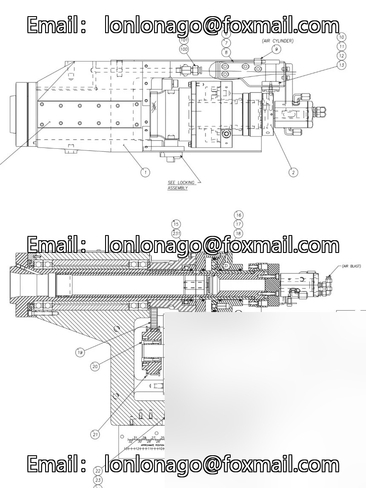
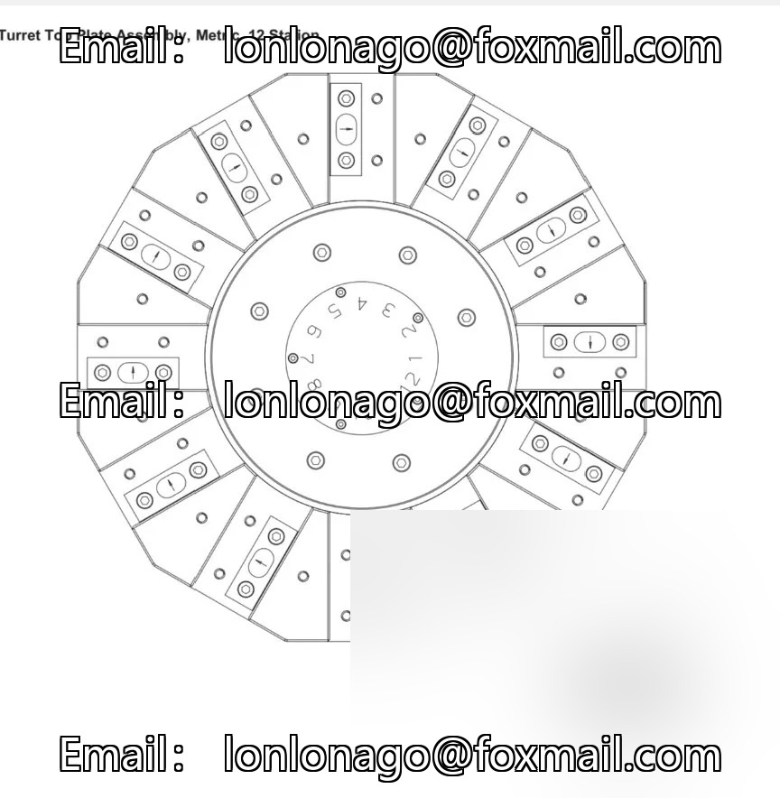
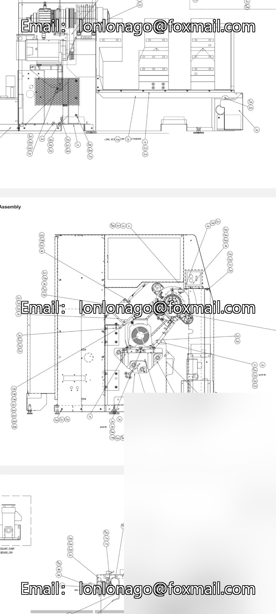
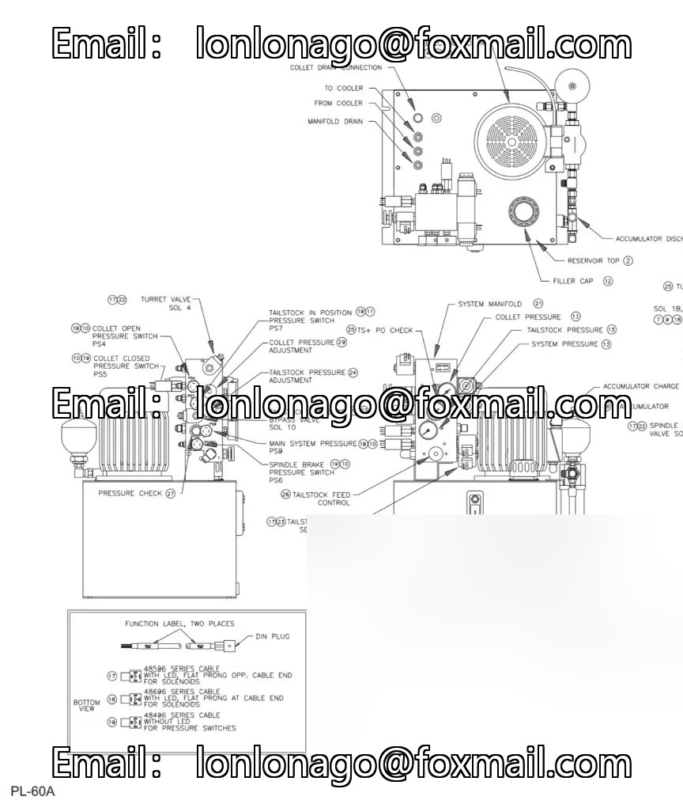
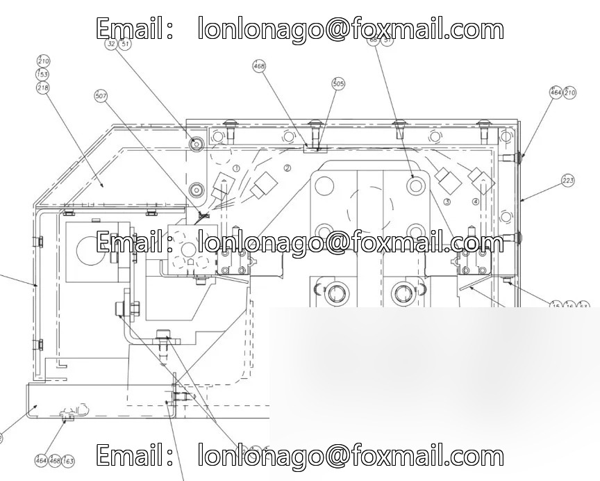
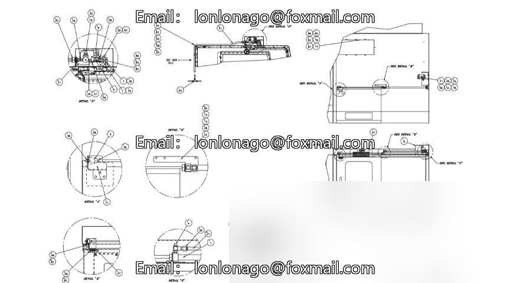

# HARDINGE (Hatt; Hatt) CONQUEST T42 series CNC

## Body

HARDINGE (Hunting) CONQUEST T42 series CNC lathe part list, PDF , total 190 pages.
Main chapters include:

Air Blast Assembly (Air Blast Device)

Auto Door (automatic door system, including light touch LIGHT TOUCH and push button PUSH BUTTON)

Bed/Base Assembly (bed frame/base)

Carriage/Cross Slide Assembly (flow board/horizontal sliding plate)

Collet Closer Assembly (Clamped Head Closer)

Coolant System (cooling system, including High Pressure option)

Chip conveyor (column cutter)

Headstock Assembly (main shaft box, distinguished by standard Standard and big bore Big Bore)

Hydraulic Unit (Hydraulic Unit)

Lubrication System (Lubrication System)

Operator Control Panel (Operating Control Panel)

Option Panel (selection panel, containing Live Tooling and Ram Turret options for power tools)

Part Catcher (workpiece capture device / material receiver device)

Spindle Assembly (main shaft component)

Sub-Spindle Assembly (sub-spindle assembly)

Tailstock Assembly (tailstock assembly component)

Turret Assembly (knife tower component, distinguished between 10 stations and 12 stations)

Content:
- Device positioning and core characteristics
- High-performance multi-task horizontal CNC turning center, supporting composite machining such as turning, milling, and drilling
- Mainly characterized by high precision, high rigidity, and compact design, suitable for the manufacturing of precision parts
- Standardly equipped with GE Fanuc 18T control system, user-friendly, with rich functions
- Dual-axis control (X/Z axes), advanced features such as secondary spindle, power tools (Live Tooling), and automated auxiliary functions (Auto Door, Part Catcher, Chip Conveyor)
- SP (Super-Precision) high-precision version, suitable for industries such as medical, aerospace, and precision instruments

- Suitable for processing complex axis, sleeve, and irregular revolute body parts, supporting simultaneous processing at both ends.
9578
upon sale.

The part list includes an air blast assembly, automatic door system, bed/base assembly, carriage/horizontal slide assembly, collet closer assembly, cooling system, chip conveyor, headstock assembly and multiple supporting assemblies; it also features part catchers, spindle components and tailstock components.

<!-- AI_ENRICHED -->

## Images

## Payment

Here is a pay link on Stripe ( https://buy.stripe.com/3cs8yP7sY87d0vu9AB ). Please contact me lonlonago@foxmail.com after funding $89, and I will send you a complete data files , thank you!

